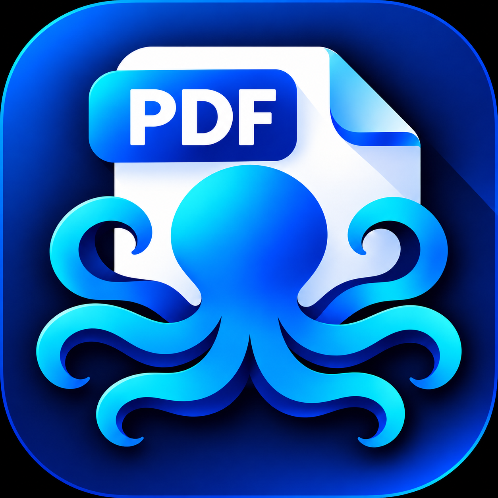

<p align="center">
  
</p>

<h1 align="center">OctoPDF</h1>

<p align="center">
  <strong>A private, offline-first PDF reader and document toolkit for Android.</strong><br/>
  Built for phones and tablets, with an Arabic-first interface.
</p>

<p align="center">
  <a href="https://github.com/Octopus205/OctoPDF/actions/workflows/build-apk.yml"></a>
  
  
  
</p>

---

## Overview

OctoPDF is an Android PDF application focused on a clean reading experience, reliable local document handling, and practical PDF utilities. It is developed with Kotlin, Jetpack Compose, and Material 3.

**The app does not require an account or an internet connection to open, read, search, or process local PDF files.** Documents remain on the device unless the user explicitly exports a result to a location they choose.

## Current capabilities

### Reading and document library
- Open PDF files through Android's Storage Access Framework.
- Continuous vertical reading, pinch-to-zoom, and double-tap zoom.
- Fit-to-width reading and light/night page rendering modes.
- Recent documents and favorites.
- Multiple open-document tabs with session restoration.
- Remember the last reading page for each document.
- Bookmarks and direct page navigation.
- Search text inside a PDF and jump to matching pages.
- Side-by-side document reading on tablets, with a compact stacked layout on phones.

### PDF tools
All operations create a new output file; the source documents are not intentionally overwritten.

| Tool | Status |
|---|---|
| Merge multiple PDF files | Available |
| Extract selected pages / split by page range | Available |
| Rotate all pages by 90° | Available |
| Reorder pages using a page sequence | Available |
| Password-protect a PDF copy | Available |
| Page thumbnails and visual page organizer | Planned |
| Annotations, highlights, and signatures | Planned |
| Crop, compression, and flattening | Planned |
| OCR for scanned documents | Planned |

> Text search works with selectable PDF text. Scanned pages that contain only images need OCR, which is not implemented yet.

## Design and platform

- Dark, minimal interface with adaptive navigation for phones and tablets.
- Arabic and right-to-left (RTL) interface support.
- Android 8.0 (API 26) and newer.
- ARM 32-bit (`armeabi-v7a`) and ARM 64-bit (`arm64-v8a`).
- Offline-first: no internet permission is required by the app.
- Local preferences and reading state are stored with Android DataStore.

## Technology

- **Kotlin** and **Jetpack Compose** — application and adaptive UI.
- **Material 3** — interface components and theming.
- **PDFium-based viewer** — PDF page rendering and navigation.
- **PDFBox-Android** — text extraction and document operations.
- **DataStore** — recent files, favorites, tabs, bookmarks, and reading position.
- **Coroutines** — background document processing.

## Build

### Requirements
- JDK 17
- Android SDK Platform 36 and Build Tools 36.0.0
- Gradle 8.13 or compatible

### Build a debug APK

From the repository root:

```bash
gradle :app:assembleDebug
```

APK output:

```
app/build/outputs/apk/debug/app-debug.apk
```

The GitHub Actions workflow builds the debug APK on pushes to `main` when app or build configuration files change, and can also be started manually from the Actions tab. The generated artifact is named `OctoPDF-debug`.

## Roadmap

The work is being delivered in focused batches to keep the app buildable:

1. **Foundation and product UI** — project structure, visual identity, adaptive navigation, and document library.
2. **Advanced reader** — reading controls, page navigation, search, bookmarks, tabs, and split view.
3. **Editing experience** — annotations, highlighting, signatures, and richer editing tools.
4. **PDF management** — merge, extract/split, rotate, reorder, and further document utilities.
5. **Smart tools and hardening** — OCR, compression improvements, performance, accessibility, automated tests, and release readiness.

Items listed as planned are not yet available in the current app. The project is under active development and is not yet a stable production release.

## Repository scope

This repository is dedicated to **OctoPDF**. Other applications are maintained in their own repositories.

## License

See the [LICENSE](LICENSE) file.
